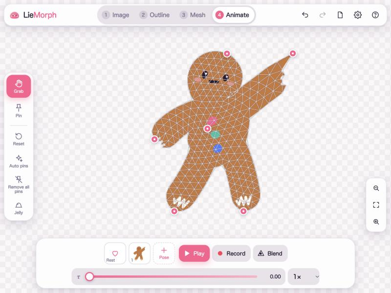

# LieMorph（リーモーフ）

[English](README.md) | **日本語**

<p align="center">
  <a href="https://shizuo-kaji.github.io/liemorph/"><b>▶&nbsp; ブラウザで LieMorph を開く </b></a><br>
  <sub>インストール不要。マウス・タッチ（複数の指）・ペンに対応。処理はすべて手元のブラウザ内で行い、画像はどこにもアップロードされません。</sub>
</p>

<p align="center">
  <a href="https://shizuo-kaji.github.io/liemorph/"></a>
</p>

画像を入れると、輪郭の抽出、三角形分割、ピンの配置までを自動で行います。そのまま指やマウスでつまんで、伸ばしたり、ポーズをつけたり、アニメーションさせたりできます。
どの段階も手で修正でき、研究者向けにアルゴリズムの細かい設定、手法の比較表示、データの書き出しも用意しています。

## 名前の由来

**Lie** は **ソフス・リー（Sophus Lie）**、つまりリー群・リー代数の「リー」です。**Morph** は形の補間（モーフィング）を表します。

このアプリの中心は、変形を**行列のままではなく、リー代数の上で混ぜる**形状補間です。
各三角形の局所的な変形は 2×2 行列 $`A`$ で表せます。これを回転と伸縮に分けて $`A = R(\theta)\,S`$ とし、それぞれを線形空間に移します。

* 回転 $`R(\theta) = \exp(\theta J)`$ は、リー代数 $`\mathfrak{so}(2) \cong \mathbb{R}`$ の元 $`\theta J`$ で表します（$`J = \left(\begin{smallmatrix}0&-1\\1&0\end{smallmatrix}\right)`$）。
* 対称正定値の伸縮 $`S`$ は、行列対数 $`\log S`$（対称行列）で表します。

あとは普通の線形演算で混ぜ、指数写像で元に戻すだけです。

```math
A(w) \;=\; \exp\!\Big(\sum_j w_j\,\theta_j J\Big)\,\exp\!\Big(\sum_j w_j \log S_j\Big).
```

リー代数の上で考えると、実用上うれしい性質が 2 つあります。

* **回転が正しい向きに進む。** $`\theta`$ は $`2\pi`$ を法とする角度ではなく実数です。それを選ぶことは、群 $`SO(2)`$ からリー代数へ持ち上げることにあたります。LieMorph はこの持ち上げを、隣り合う三角形の間でも、時間方向にも一貫させます。270° 回した腕は 270° 回り続け、逆向きに 90° 戻ったりしません。
* **伸縮が掛け算的に混ざる。** 「伸びなし」と「横に 4 倍」の中間は 2.5 倍ではなく 2 倍です。$`(\theta, \log S)`$ について線形なので、重みは何でも使えます。負の重み（外挿・誇張）も、スプライン重み（なめらかなタイミング）も使えます。

この考え方は次の論文で解析したものです。
**S. Kaji, S. Hirose, S. Sakata, Y. Mizoguchi, K. Anjyo, [*Mathematical Analysis on Affine Maps for 2D Shape Interpolation*](https://doi.org/10.2312/SCA/SCA12/071-076), Proc. ACM SIGGRAPH/Eurographics Symposium on Computer Animation (SCA) 2012, pp. 71–76.**
LieMorph は、著者らが 2012 年に Maple で行った実験を、対話的な Web アプリとして作り直したものです。

## しくみ

| ステップ | 内容 |
|---|---|
| **1 · 画像** | ドラッグ＆ドロップ、ファイル選択、カメラ（スマホ・タブレット）、貼り付けで画像を読み込みます。内蔵サンプルや 2012 年の実験データから始めることもできます。 |
| **2 · 輪郭** | 前景は、透明度（アルファ）があればそれを使います。なければ、画像の縁から推定した背景色（k-means）との CIELAB 色差を大津の方法で二値化して求めます。そのあとモルフォロジー処理と穴埋めを行い、マーチングスクエアで輪郭を取り、Douglas–Peucker で単純化します。点のドラッグ・追加・削除や、マスクの塗り／投げ縄（ペンの筆圧に対応）で修正できます。 |
| **3 · メッシュ** | 輪郭に沿った制約付き Delaunay 三角形分割です。内部の点は六角格子かポアソンディスクで配置し、細い部分は距離変換から作るサイズ場によって辺が短くなります。仕上げに緩和処理で三角形を整えます。頂点の移動・追加・削除ができ、メッシュの品質（最小角・半径比）も表示します。 |
| **4 · 動かす** | **ARAP（as-rigid-as-possible）変形**を局所–大域法で解きます。三角形ごとに最も近い回転を求め、事前に分解した余接ラプラシアンで疎な連立方程式を 1 回解きます。ピンは重心座標で表したソフト制約で、指 1 本ごとに別の点をつかめます。「ぷるぷる」モードでは、projective dynamics 風の陰的な動力学が加わります。ポーズを保存しておけば、上の方法で再生したり混ぜたりできます。 |

**「動かす」での操作。** タップでピンを付け外し、ドラッグで引っ張り、何もない所を 2 本指でつまむとズームします。
「＋ポーズ」で今の形を保存し、▶ で順に再生します。「ブレンド」パッドでは置いた位置に応じてポーズが混ざり、外側に置くと誇張されます。「録画」は手の動きをそのままクリップとして記録します。

## 研究者向け

* **補間法：** 極分解＋対数（Kaji et al. 2012）、極分解＋線形（Alexa et al. 2000）、アフィン線形、頂点の線形補間を選べます。別の手法の輪郭を重ねて比較することもできます。
* **回転角の分枝：** 「追跡」は操作したとおりの角度を使い、「一貫」は三角形の隣接関係を BFS でたどって揃えます。「主値」は $`(-\pi, \pi]`$ のままで、古典的な破綻の再現用です。ポーズごとに ±1 回転の指定もできます。
* **変形の設定：** 剛性（ARAP ↔ ASAP）、面積重み／一様重み、反復回数、ぷるぷるモードの硬さ・減衰・重力を調整できます。
* **ヒートマップと統計：** 歪み $`\sigma_1/\sigma_2`$、面積比 $`\det J`$、回転角 $`\theta`$、三角形の品質を色で表示します。統計として ARAP エネルギー、反転した三角形の数、分解と求解の時間も表示します。
* **書き出し：** 透過 PNG、WebM/MP4 動画、プロジェクト `.json`（ブラウザ内に自動保存も）、UV 付きメッシュ `.obj`、ワイヤーフレーム `.svg`、ポーズデータ `.json`、2012 年の Maple 形式 `.mpl`（`p := […]: T := […]:`）。`.mpl` は読み込みもできます。
* **コンソールから操作：** `window.liemorph.app` を使えます。例：`liemorph.app.ensureInterp().blend(weights, 'polar-log', out)`

| 2012 年の Maple ワークシート | LieMorph |
|---|---|
| `Aff`, `splAff`, 極分解 | `src/geom/mat2.ts`, `MeshOperator.jacobian` |
| `rotFix`（回転角の一貫化） | `Interpolator.consistentAngles` |
| `locus_E`, `sqmethod`（最小二乗） | `Interpolator.blend` ＋ 包絡 Cholesky 分解（`src/geom/sparse.ts`） |
| `PolarLinearBlend`, `ExpBlend`, 3 形状の重み空間 | 補間法 `polar-linear` / `polar-log`、ブレンドパッド |
| `smooth_triangulation` | 緩和処理＋サイズ場（`src/geom/mesh.ts`） |
| ドラッグで変形するパネル | `Deformer`（`src/geom/arap.ts`） |
| Shewchuk の *Triangle*＋Perl の変換スクリプト | Delaunator＋Constrainautor、`src/io/maple.ts` |

## 開発

```bash
npm install
npm run dev        # http://localhost:5173
npm test           # 幾何処理のユニットテスト（Node 22 以上なら TypeScript をそのまま実行）
npm run build      # 型チェック＋本番ビルド（dist/ に出力）
```

TypeScript で書いており、フレームワークは使っていません。

* `src/geom/` は DOM に依存しない中核部分です（輪郭検出、メッシュ生成、ARAP、補間、疎行列ソルバー）。テストはここを対象にしています。
* `src/app.ts` は全体の制御です。
* `src/ui/` は画面まわりです。
* `src/render/` は WebGL とオーバーレイの描画です。

## 参考文献

* S. Kaji, S. Hirose, S. Sakata, Y. Mizoguchi, K. Anjyo. *Mathematical Analysis on Affine Maps for 2D Shape Interpolation.* SCA 2012, pp. 71–76. [doi:10.2312/SCA/SCA12/071-076](https://doi.org/10.2312/SCA/SCA12/071-076)
* M. Alexa, D. Cohen-Or, D. Levin. *As-Rigid-As-Possible Shape Interpolation.* SIGGRAPH 2000.
* T. Igarashi, T. Moscovich, J. F. Hughes. *As-Rigid-As-Possible Shape Manipulation.* SIGGRAPH 2005.
* O. Sorkine, M. Alexa. *As-Rigid-As-Possible Surface Modeling.* SGP 2007.
* L. Liu, L. Zhang, Y. Xu, C. Gotsman, S. J. Gortler. *A Local/Global Approach to Mesh Parameterization.* SGP 2008.
* 関連：S. Kaji, H. Ochiai. *A Concise Parametrisation of Affine Transformation.* [arXiv:1507.05290](https://arxiv.org/abs/1507.05290)

[Delaunator](https://github.com/mapbox/delaunator)、[Constrainautor](https://github.com/kninnug/Constrainautor)（いずれも ISC ライセンス）、[Vite](https://vite.dev) を使っています。
