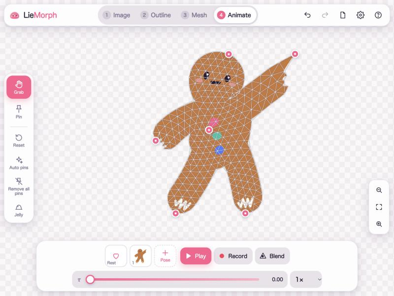

# LieMorph

**English** | [日本語](README.ja.md)

<p align="center">
  <a href="https://shizuo-kaji.github.io/liemorph/"><b>▶&nbsp; Try LieMorph in your browser </b></a><br>
  <sub>No installation. Works with mouse, touch (multi-finger) and pen. Everything runs locally — your pictures are never uploaded.</sub>
</p>

<p align="center">
  <a href="https://shizuo-kaji.github.io/liemorph/"></a>
</p>

Drop in a picture and LieMorph finds its outline, triangulates it and places pins — then you can grab it and squish, pose and animate it.
Every stage can be corrected by hand, and researchers get fine control over the algorithms, side-by-side method comparisons and data export.

## Why "LieMorph"?

*Lie* as in **Sophus Lie** — Lie groups and Lie algebras — and *morph* as in shape morphing.

The core of the app is shape interpolation that blends deformations **in the Lie algebra rather than in the space of matrices**.
The local deformation of each triangle is a 2×2 matrix $`A`$.
LieMorph splits it into a rotation and a stretch, $`A = R(\theta)\,S`$, and moves both parts to a linear space:

* the rotation $`R(\theta) = \exp(\theta J)`$, $`J = \left(\begin{smallmatrix}0&-1\\1&0\end{smallmatrix}\right)`$, is represented by $`\theta J`$, an element of the Lie algebra $`\mathfrak{so}(2) \cong \mathbb{R}`$;
* the symmetric positive-definite stretch $`S`$ is represented by $`\log S`$, a symmetric matrix.

Blending is then plain linear algebra, and the exponential map brings the result back:

```math
A(w) \;=\; \exp\!\Big(\sum_j w_j\,\theta_j J\Big)\,\exp\!\Big(\sum_j w_j \log S_j\Big).
```

Working in the Lie algebra has two practical consequences.

* **Rotations go the right way.** $`\theta`$ is a real number, not an angle modulo $`2\pi`$. Picking it means lifting from the group $`SO(2)`$ to its Lie algebra, and LieMorph makes this lift consistent across neighbouring triangles and over time. A limb turned by 270° keeps turning 270°; it does not snap back by 90°.
* **Stretches blend multiplicatively.** Halfway between "no stretch" and "4× wider" is 2× wider, not 2.5× wider. Because the blend is linear in $`(\theta, \log S)`$, any weights work, including negative ones (extrapolation or exaggeration) and spline weights (smooth timing).

This is the approach analysed in
**S. Kaji, S. Hirose, S. Sakata, Y. Mizoguchi, K. Anjyo, [*Mathematical Analysis on Affine Maps for 2D Shape Interpolation*](https://doi.org/10.2312/SCA/SCA12/071-076), Proc. ACM SIGGRAPH/Eurographics Symposium on Computer Animation (SCA) 2012, pp. 71–76.**
LieMorph is a modern, interactive re-implementation of the authors' 2012 Maple experiments.

## How it works

| Step | What happens |
|---|---|
| **1 · Image** | Load a picture by drag & drop, file picker, camera (phones and tablets) or paste. You can also start from one of the built-in samples or the original 2012 data sets. |
| **2 · Outline** | The foreground is found from the alpha channel or, for opaque images, from the CIELAB colour distance to background colours estimated on the image border (k-means), thresholded with Otsu's method. Morphology and hole filling follow, then marching squares and Douglas–Peucker simplification. Correct it by dragging, inserting or deleting points, or by painting and lassoing the mask (pen pressure is supported). |
| **3 · Mesh** | Constrained Delaunay triangulation of the outline. Interior points sit on a hexagonal lattice or a Poisson-disk sample, and thin parts get proportionally shorter edges from a distance-transform sizing field. A relaxation pass evens out the triangles. You can move, add and remove vertices, and the app shows mesh quality (minimum angle, radius ratio). |
| **4 · Animate** | **As-rigid-as-possible (ARAP) deformation** with a local–global solver: closest rotation per triangle, then one sparse solve with a pre-factored cotangent Laplacian. Pins are soft barycentric constraints, and every finger can grab its own point. *Jelly* mode adds implicit dynamics, in the style of projective dynamics. Save poses, then play them back or blend them as described above. |

**In Animate.** Tap to add or remove a pin, drag anywhere to pull, and use two fingers on empty space to zoom.
**+ Pose** stores the current shape and **▶** plays the poses in order. The **Blend** pad mixes poses by position; place the puck outside the poses to exaggerate. **Record** captures your hand motion as a clip.

## For researchers

* **Interpolation method:** polar + log (Kaji et al. 2012), polar + linear (Alexa et al. 2000), affine-linear or vertex-linear. A comparison overlay draws one method's outline on top of another's.
* **Rotation branch:** *tracked* follows the angles as you manipulated them, *consistent* propagates them by BFS over triangle adjacency, and *principal* uses $`(-\pi, \pi]`$ to show the classic artefact. Each pose also has ±1-turn controls.
* **Deformation settings:** rigidity (ARAP ↔ ASAP), area or uniform weights, solver iterations, and jelly stiffness, damping and gravity.
* **Heatmaps and statistics:** distortion $`\sigma_1/\sigma_2`$, area ratio $`\det J`$, rotation $`\theta`$, triangle quality, ARAP energy, flipped triangles, factorisation and solve times.
* **Export:** transparent PNG, WebM/MP4 video, project `.json` (also autosaved in the browser), mesh `.obj` with UVs, wireframe `.svg`, pose data `.json`, and the 2012 Maple format `.mpl` (`p := […]: T := […]:`), which can also be opened.
* **Console access:** `window.liemorph.app`, for example `liemorph.app.ensureInterp().blend(weights, 'polar-log', out)`.

| 2012 Maple worksheet | LieMorph |
|---|---|
| `Aff`, `splAff`, polar decomposition | `src/geom/mat2.ts`, `MeshOperator.jacobian` |
| `rotFix` (consistent rotation angles) | `Interpolator.consistentAngles` |
| `locus_E`, `sqmethod` (least squares) | `Interpolator.blend` + envelope Cholesky (`src/geom/sparse.ts`) |
| `PolarLinearBlend`, `ExpBlend`, 3-way weight space | methods `polar-linear` / `polar-log`, the blend pad |
| `smooth_triangulation` | relaxation + sizing field (`src/geom/mesh.ts`) |
| drag-to-deform panel | `Deformer` (`src/geom/arap.ts`) |
| Shewchuk's *Triangle* + Perl converters | Delaunator + Constrainautor, `src/io/maple.ts` |

## Development

```bash
npm install
npm run dev        # http://localhost:5173
npm test           # unit tests for the geometry code (Node ≥ 22 runs the TypeScript directly)
npm run build      # type-check + production build into dist/
```

The code is in TypeScript and uses no framework.

* `src/geom/` holds the DOM-free core: outline detection, meshing, ARAP, interpolation and the sparse solver. The tests cover this part.
* `src/app.ts` is the controller.
* `src/ui/` is the interface.
* `src/render/` handles WebGL and overlay drawing.

## References

* S. Kaji, S. Hirose, S. Sakata, Y. Mizoguchi, K. Anjyo. *Mathematical Analysis on Affine Maps for 2D Shape Interpolation.* SCA 2012, pp. 71–76. [doi:10.2312/SCA/SCA12/071-076](https://doi.org/10.2312/SCA/SCA12/071-076)
* M. Alexa, D. Cohen-Or, D. Levin. *As-Rigid-As-Possible Shape Interpolation.* SIGGRAPH 2000.
* T. Igarashi, T. Moscovich, J. F. Hughes. *As-Rigid-As-Possible Shape Manipulation.* SIGGRAPH 2005.
* O. Sorkine, M. Alexa. *As-Rigid-As-Possible Surface Modeling.* SGP 2007.
* L. Liu, L. Zhang, Y. Xu, C. Gotsman, S. J. Gortler. *A Local/Global Approach to Mesh Parameterization.* SGP 2008.
* Related: S. Kaji, H. Ochiai. *A Concise Parametrisation of Affine Transformation.* [arXiv:1507.05290](https://arxiv.org/abs/1507.05290)

Built with [Delaunator](https://github.com/mapbox/delaunator) and [Constrainautor](https://github.com/kninnug/Constrainautor) (both ISC licence) and [Vite](https://vite.dev).
